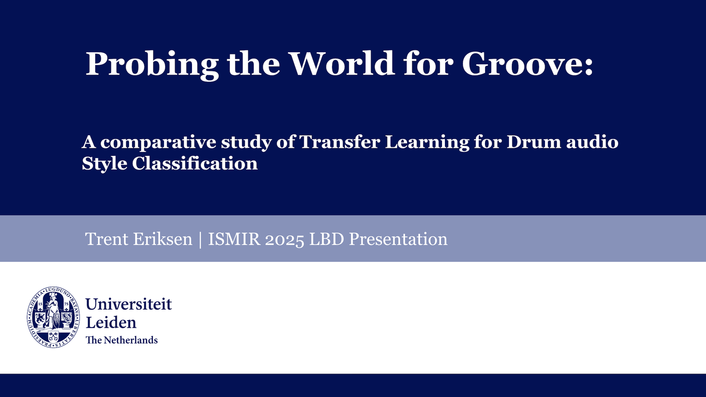

# Probing the World for Groove

**Trent Eriksen** · MSc Media Technology, Leiden University (LIACS)<br>
The research website for the MSc thesis and the ISMIR 2025 Late-Breaking Demo, *A Comparative Study of Transfer
Learning for Drum Audio Style Classification*

[](https://grashopr-888.github.io/probing-the-world-for-groove/)
[](https://ismir2025program.ismir.net/lbd_456.html)
[](https://youtu.be/f_nIl5qMxlY)
[](https://github.com/Grashopr-888/A-comparative-study-of-Transfer-Learning-for-Drum-audio-Style-Classification-)
[](https://grashopr-888.github.io/current-projects/projects/groove/)
[](LICENSE)
[](https://scholar.google.com/citations?user=mUE3lGAAAAAJ)

<p align="center">
  <a href="https://youtu.be/f_nIl5qMxlY"></a>
  <br><sub><a href="https://youtu.be/f_nIl5qMxlY">Watch the ISMIR 2025 presentation</a></sub>
</p>

> The thesis now also lives on [Current Projects](https://grashopr-888.github.io/current-projects/projects/groove/),
> alongside the author's other work. This repository is the original standalone site, still online.

---

## The question

> Can a model trained on *general* audio understand *drum style*?

A baseline **CNN trained from scratch** is compared against a **frozen, AudioSet-pretrained
PaSST** transformer on **18,264** two-bar drum clips spanning **74** style classes.

## The finding

A drum-specific CNN reached the strongest aggregate score on the full 74-class task, while
frozen PaSST transfer learning was more competitive under data scarcity and produced a more
stable, hierarchical representation of style. Transfer learning helped — but its value depended
on data availability, classifier design, and how well AudioSet pretraining aligned with
fine-grained drum-style distinctions.

| Result | CNN | PaSST |
| --- | --- | --- |
| **Full data, 74 classes (macro-F1)** | **0.9080** | 0.8752 |
| Low-data (GMD-mini, macro-F1) | 0.3267 | **0.3911** |
| Best architecture | 7 conv layers | 4-layer MLP head |
| Best intervention | Gaussian noise + room sim | reflection padding |

> The early rock-only experiment scored 0.9204 on a narrower, easier label set — it is part of
> the experiment history, not the headline result.

## Model comparison

| | CNN | PaSST |
| --- | --- | --- |
| Input | mel spectrogram, 16 kHz | 32 kHz, padded to 10 s |
| Backbone | VGG-style, **trained from scratch** | Patchout AST, **frozen** (AudioSet) |
| Classifier | 7 convolutional layers | 4-layer MLP head |
| Inductive bias | local spectro-temporal | transferred general-audio |

---

## This repository

A static [Astro](https://astro.build) site — an editorial layer over the research repository.

```
├── src/
│   ├── pages/          # Overview, Method, Experiments, Representations, Publication, Resources
│   ├── components/     # MetricCard, DotPlot, RankedBars, ModelBadge, VideoEmbed, Cite, …
│   ├── layouts/ lib/ styles/
│   └── data/           # experiments.json, experiment-rounds.json, key-results.json, embedding-comparisons.json (generated)
├── public/             # papers, poster, workbook, figures, audio
├── scripts/            # extract_experiments.py, extract_embeddings.py, audit_notebooks.py
├── docs/               # site-audit.md, content-provenance.md
└── .github/workflows/  # deploy.yml (GitHub Pages via Actions)
```

### Develop

```bash
npm install
npm run dev       # http://localhost:4321/probing-the-world-for-groove/
npm run build
npm run preview
```

### Regenerate research data (optional)

```bash
python3 scripts/extract_experiments.py   # workbook → src/data/*.json (with validation)
python3 scripts/extract_embeddings.py    # centroid-shift data → embedding-comparisons.json
```

The site **never executes notebooks** — it builds from saved outputs and the experiment workbook.
Every headline number is traced in [`docs/content-provenance.md`](docs/content-provenance.md).

---

## Citation

See [CITATION.cff](CITATION.cff) and the [publication page](https://grashopr-888.github.io/probing-the-world-for-groove/publication) for the thesis and ISMIR LBD citations (with BibTeX).

## Attribution & licensing

Audio derives from the [Groove MIDI Dataset](https://magenta.tensorflow.org/datasets/groove)
(Google / Magenta, **CC BY 4.0**). See [LICENSES.md](LICENSES.md) for a breakdown of code,
content, dataset, and third-party licensing.
